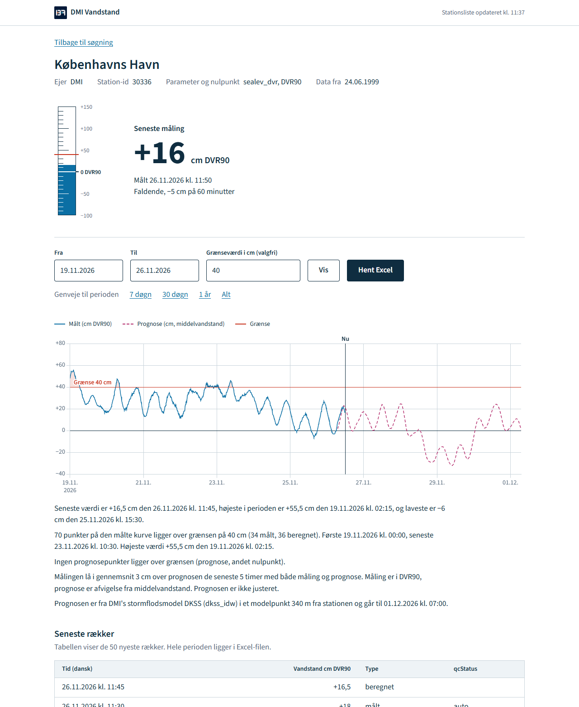

# DMI Vandstand

Version 1.1 · [bilmpz.github.io/DMI-Vandstand](https://bilmpz.github.io/DMI-Vandstand/)

DMI vandstand bygget med Claude

## Formål

Skriv et postnummer, og få de fem nærmeste vandstandsstationer med seneste måling. For en valgt station viser siden den målte vandstand i en valgt periode og DMI's prognose for de næste fem døgn. Det hele kan hentes som en fil, der åbner direkte i dansk Excel.

Siden har samme opbygning som [Bilmpz/DMI](https://github.com/Bilmpz/DMI): et C#-program bygger en stationsliste, og en statisk side på GitHub Pages henter data direkte fra DMI i browseren.



## Sådan virker det

1. Postnummeret slås op i `docs/data/postnumre.json` og bliver til en koordinat.
2. Afstanden til hver station beregnes med haversine-formlen, og de fem nærmeste steder vises. Stationer med samme ejer og samme navn (uden I, II eller III til sidst) under 1 km fra hinanden tæller som ét sted. Man kan skifte måler i stationsvisningen.
3. Seneste måling, målinger i perioden og prognosen hentes direkte fra DMI, hver gang man åbner, søger eller henter.
4. Graf, tabel og Excel-fil bygger på det samme datasæt med ét punkt pr. kvarter.

## Datakilder

| Data | Kilde |
| --- | --- |
| Målt vandstand | DMI's Frie Data, `oceanObs`. Målingerne kommer fra DMI, Kystdirektoratet og havne/kommuner, som ejer stationerne. |
| Prognose | DMI's stormflodsmodel DKSS via `forecastedr`, parameteren `sea-mean-deviation`. |
| Postnumre | [GeoNames](https://www.geonames.org/), CC BY 4.0. |

Kilde: DMI. DMI's Frie Data er udgivet under [CC BY 4.0](https://creativecommons.org/licenses/by/4.0/legalcode.da). DMI's vilkår kræver teksten "Kilde: DMI" ved rå data og "Baseret på data fra DMI og efterfølgende bearbejdet" ved bearbejdede data, og at tidspunktet for hentningen oplyses. Siden skriver begge dele i sidefoden sammen med tidspunktet. Rækker mærket "beregnet" er de bearbejdede data. DMI's API kræver ingen nøgle.

DMI skriver, at observationerne er rå data, som ikke er kvalitetssikrede og kan indeholde fejl.

## De 7 beslutninger

1. **Stationer.** Med er DMI-stationer, der har `sealev_dvr`, Kystdirektoratets stationer med `sea_reg` og stationer ejet af havne og kommuner med `sea_reg`. DMI skriver deres ejer som "Kommuner/Havne" eller "Harbours & municipalities", og siden skriver "Havn/kommune". DMI dokumenterer ikke nulpunktet for deres `sea_reg`, så siden skriver "cm" i stedet for "cm DVR90" og siger det i stationshovedet. Stationer uden ejer og DMI-stationer uden `sealev_dvr` er ikke med.
2. **15 minutter.** Datasættet har altid punkter kl. :00, :15, :30 og :45. DMI måler hvert 10. minut, så :15 og :45 beregnes mellem nabomålingerne og mærkes "beregnet".
3. **Historik.** Så langt tilbage, som stationen har data. Der er ingen fast nedre grænse.
4. **Altid nyeste data.** Målinger og prognose hentes direkte fra DMI i browseren.
5. **To nulpunkter.** Målingen er i DVR90, prognosen er afvigelse fra middelvandstand. Siden viser forskellen og retter aldrig prognosen. For havnenes og kommunernes stationer er målingens nulpunkt ikke dokumenteret af DMI, og det står ved forskellen.
6. **Dansk tid.** Alle tider vises i Europe/Copenhagen, også når browseren står i en anden tidszone.
7. **Ingen filtrering til hele timer.** Alle kvarterer er med.

### Regler for 15-minutters datasættet

- Findes der en måling præcis på kvarteret, bruges den: type "målt", `qcStatus` fra DMI.
- Ellers findes nærmeste måling før og efter. Ligger de højst 20 minutter fra hinanden, beregnes værdien lineært mellem dem og afrundes til 1 decimal: type "beregnet", tom `qcStatus`.
- Ellers er der ingen række for det kvarter. Siden tæller hullerne og skriver antallet under grafen.
- Målinger kl. :10, :20, :40 og :50 indgår kun i beregningen og får ikke egne rækker.

### Excel-filen

CSV med semikolon, decimalkomma, CRLF og UTF-8 med BOM. Kolonner:

`Tid UTC; Tid dansk; Vandstand cm DVR90; Type; qcStatus; Prognose cm (middelvandstand)`

For stationer ejet af havne og kommuner hedder den tredje kolonne `Vandstand cm (nulpunkt ikke dokumenteret)`.

Type er "målt", "beregnet" eller "prognose". Prognosen står i sin egen kolonne på hele timer. Efter seneste måling kommer der kun timerækker med type "prognose". Prognosen er med, når Til er i dag. Har perioden over 1.000.000 rækker, deles filen i flere på hele år.

Filnavn: `vandstand_{stationId}_{navn}_{parameter}_{fra}_{til}.csv`

## Målt 26.11.2026

Tallene er målt mod DMI's API den dag, version 1.0 blev bygget.

- Stationslisten har 211 records for 178 stationer. 80 er med: 32 fra DMI med `sealev_dvr` og 48 fra Kystdirektoratet med `sea_reg`. De udgør 61 steder.
- 78 af de 80 har et prognosepunkt: 43 i `dkss_idw`, 14 i `dkss_nsbs`, 13 i `dkss_ws`, 5 i `dkss_lb`, 2 i `dkss_lf` og 1 i `dkss_if`. Bork Havn og Felsted Kog/Klosterhul har ingen prognose.
- DKSS-modellernes gitter fra finest til grovest: `dkss_lf` ca. 170 x 185 m, `dkss_lb` og `dkss_if` ca. 175 x 309 m, `dkss_idw` ca. 877 x 927 m, `dkss_ws` ca. 1,8 km og `dkss_nsbs` ca. 5,2 x 5,6 km.
- Tre måneders målinger for Københavns Havn (30336) er 12.747 rækker og 3,7 MB JSON og tog 1,0 sekund. Et år er 51.604 rækker og 15,0 MB og tog 2,7 til 3,9 sekunder.
- Perioden hentes i kalenderkvartaler med 3 kald ad gangen. Tre år tog 4,9 sekunder i kvartaler, 6,3 i halvår og 6,6 i hele år.
- "Alt" for Københavns Havn (fra 24.06.1999) tog 40 sekunder på den deployede side. Excel-filen fik 906.429 rækker og fylder 45,7 MB.
- "Alt" for Thyborøn Havn (fra 03.10.1990) tog 47 sekunder og gav 1.228.201 rækker. Filen blev delt i to: 1990 til 2018 med 972.662 rækker og 2019 til 2026 med 255.539 rækker.
- Alle tre endpoints svarer med `Access-Control-Allow-Origin: *`, så browseren kan kalde dem direkte.

## Kør lokalt

Kræver .NET 10 SDK.

```
dotnet run --project DmiVandstand
```

Programmet skriver `docs/data/stations.json`. Prognosepunkter genbruges fra den eksisterende fil og beregnes kun for nye stationer. Alle beregnes forfra med:

```
dotnet run --project DmiVandstand -- --refresh-forecast
```

Den første beregning af alle 80 prognosepunkter tog 14 minutter og 237 kald, fordi DMI's prognose-API svarede langsomt. En almindelig kørsel bruger ét kald og nogle få sekunder.

Siden skal åbnes gennem en lokal server, for eksempel:

```
npx http-server docs -p 8080
```

Åbn derefter `http://localhost:8080/`.

## Sådan virker workflowet

`.github/workflows/update-dmi.yml` kører hver halve time, ved push til `main` og manuelt. Det henter koden, installerer .NET 10, kører programmet og deployer mappen `docs/` til GitHub Pages. Den nye `stations.json` bliver ikke committet. Den ligger kun i den deployede side.

Svarer DMI ikke, eller finder programmet under 30 stationer, overskriver det ikke filen. Det skriver en advarsel i workflowet og afslutter med kode 0, så siden stadig deployes med den committede fil.

GitHub slår planlagte workflows fra i et offentligt repo, når der ikke har været aktivitet i repoet i 60 dage. Så bliver stationslisten ikke længere opdateret, men siden virker stadig, og målinger og prognose hentes fortsat live fra DMI. Workflowet slås til igen under Actions med "Enable workflow" eller med `gh workflow enable update-dmi.yml`. GitHub oplyser også, at planlagte kørsler kan blive forsinket eller sprunget over, når der er travlt.

## Kendte begrænsninger

- **Rå data med fejl.** Siden viser DMI's målinger uden at filtrere dem. Københavns Havn har for eksempel +325 cm den 25.12.2025 kl. 21:30 mellem to målinger på −18 og −19 cm, og +777 cm den 24.11.2015. En fejlmåling kl. :10 eller :20 påvirker også den beregnede værdi kl. :15.
- **Prognosen har et andet nulpunkt.** Den er afvigelse fra middelvandstand og er ikke omregnet til DVR90. Siden skriver den gennemsnitlige forskel i de timer, hvor der er både måling og prognose.
- **Havne og kommuner: nulpunkt ikke dokumenteret.** DMI oplyser ikke, hvilket nulpunkt havnenes og kommunernes `sea_reg` er målt i. Siden skriver værdierne i "cm" uden DVR90, og de kan ikke uden videre sammenlignes med DMI's og Kystdirektoratets stationer.
- **Prognosepunktet kan ligge langt væk.** Punktet er det nærmeste gitterpunkt med værdier i den fineste model, der dækker stationen. For 14 stationer er det den grove model `dkss_nsbs`. Ringkøbing Havn (14,4 km), Nees (8,1 km) og Thorsminde Fjord (5,2 km) ligger i fjorde bag sluser og får et punkt i Nordsøen. Siden skriver afstanden og advarer, når den er over 5 km.
- **DMI svarer nogle gange 429 ("Server is busy").** Det er set på både prognoser og målinger. En bid af perioden, der fejler, prøves igen 2 gange med 3 og 8 sekunders pause, og de andre kald venter imens. Bidder, der stadig mangler, prøves en sidste gang, når resten er hentet. Mangler der derefter noget, skriver siden, hvilken periode det er. Prognosen prøves igen 2 gange.
- **Ældre data er grovere.** Før midten af 2001 er der målt hvert 15., 30. eller 60. minut. Timedata giver kun rækker på hele timer, og de øvrige kvarterer tælles som huller.
- **Lange perioder er tunge.** "Alt" henter over en million målinger for de ældste stationer. Det kan være for meget for en telefon.
- **De nyeste kvarterer.** DMI's målinger kommer med 5 til 20 minutters forsinkelse. Kvarterer uden måling tælles derfor kun frem til 30 minutter før nu.
- **Datoer skrives i hånden** som dd.mm.åååå. Der er ingen kalender.
- **Afstanden er i fugleflugt** fra postnummerets koordinat til stationen.
- **Ikke med:** søer og vandløb, kort, login, database og notifikationer.

## Filer

| Sti | Indhold |
| --- | --- |
| `DmiVandstand/` | C#-konsolprogram (.NET 10), der bygger stationslisten |
| `docs/index.html`, `docs/style.css`, `docs/app.js` | Siden. Ingen byggeværktøjer og ingen frameworks |
| `docs/data/stations.json` | Stationer med ejer, parameter, koordinat, startdato og prognosepunkt |
| `docs/data/postnumre.json` | 1.154 postnumre med koordinater |
| `docs/vendor/` | Chart.js 4.6.2 (MIT-licens) |
| `docs/fonts/` | Source Sans 3 (SIL Open Font License) |
| `screenshots/` | Skærmbilleder i 390 px og 1280 px bredde |
| `.github/workflows/update-dmi.yml` | Workflow, der opdaterer stationslisten og deployer siden |

Made by Oliver Lobel
